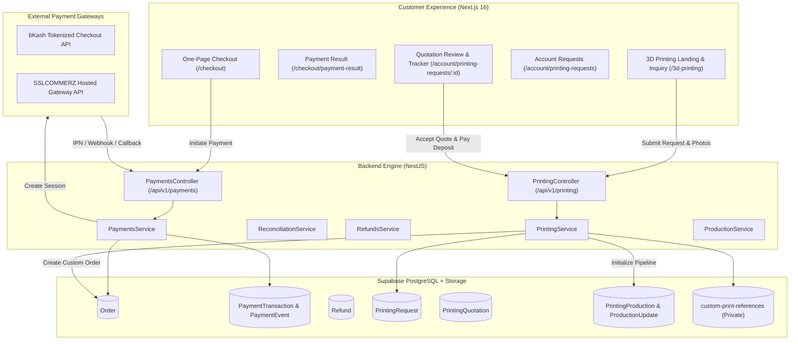

# HIMATU — Stage 3 Step 2C Architecture Specification
## Multi-Channel Payment Gateways & Custom 3D Printing Manufacturing Pipeline

---

## 1. System Overview

HIMATU Stage 3 Step 2C transforms the platform into an end-to-end commerce and custom anime collectible manufacturing system for Bangladesh. The architecture integrates two primary sub-systems:

1. **Payments Subsystem (`PaymentsModule`)**: Centralized multi-channel payment engine supporting Direct bKash merchant checkout, SSLCOMMERZ multi-channel hosted checkout (Visa, Mastercard, AMEX, Internet Banking), and Cash on Delivery (COD), with idempotent webhooks/IPN, transaction logging, automated queries, manual reconciliations, and audit-logged refund processing.
2. **Custom 3D Printing Subsystem (`PrintingModule`)**: End-to-end bespoke figure manufacturing pipeline comprising public customer inquiry submission, private reference photo uploads (`custom-print-references`), commercial quotation engine with itemized cost calculators and 50% commitment deposits, interactive customer quotation approval, linked order creation, and a 10-stage fabrication Kanban board.



---

## 2. Monorepo Organization

```
himatu/
├── apps/
│   ├── api/
│   │   ├── prisma/
│   │   │   ├── schema.prisma (Extended with 7 new models)
│   │   │   └── migrations/ (PostgreSQL DDL migrations)
│   │   ├── src/
│   │   │   ├── payments/ (Gateway abstraction, bKash, SSLCOMMERZ, COD, Reconciliation, Refunds)
│   │   │   ├── printing/ (Request management, quotation engine, 10-stage production Kanban)
│   │   │   ├── storage/ (Private bucket custom-print-references & signed URLs)
│   │   │   └── auth/ (Guards, roles, OptionalAuthGuard)
│   │   └── test/ (Unit and integration tests for payments & printing)
│   └── web/
│       ├── src/
│       │   ├── app/
│       │   │   ├── 3d-printing/page.tsx (Public inquiry page)
│       │   │   ├── checkout/payment-result/page.tsx (Verification screen)
│       │   │   ├── account/printing-requests/ (Customer quotation & timeline tracker)
│       │   │   └── admin/
│       │   │       ├── payments/ (Reconciliation & refunds workspace)
│       │   │       ├── 3d-printing/ (Quotation builder & inquiry dossier)
│       │   │       └── 3d-printing/production/ (10-stage Kanban board)
│       │   ├── components/
│       │   │   ├── commerce/CheckoutForm.tsx (Active bKash, SSL, COD selector)
│       │   │   ├── services/PrintingInquiry.tsx (Bespoke commission form)
│       │   │   └── admin/ (PaymentManagement, PrintingManagement, ProductionKanban)
│       │   └── lib/commerce-api.ts (Typed client methods)
│       └── test/ (Frontend commerce API integration tests)
└── packages/
    └── shared/ (Data Transfer Objects & TypeScript definitions)
```

---

## 3. Core Database Entities

1. `PaymentTransaction`: Unique transaction ref (`TXN-YYYYMMDD-XXXXXX`), order relationship, provider (`BKASH`, `SSLCOMMERZ`, `COD`), provider transaction ID, amount in minor units, status (`PENDING`, `PAID`, `FAILED`, `REFUNDED`), and verification status.
2. `PaymentEvent`: Immutable audit log capturing state transitions (`INITIATED`, `CALLBACK_RECEIVED`, `VERIFIED`, `REFUNDED`).
3. `Refund`: Audit record (`REF-YYYYMMDD-XXXX`), amount, reason, gateway refund reference ID, status, and administrator ID.
4. `PrintingRequest`: Bespoke inquiry (`PR-YYYY-XXXX`), character, anime, scale, material, finish preferences, budget estimate, and status.
5. `PrintingReferenceImage`: Reference image storage path in private bucket `custom-print-references`, file metadata.
6. `PrintingQuotation`: Commercial quote (`QUO-YYYY-XXXX`), itemized costs (sculpting, material, printing, painting, finishing, shipping, discounts), total amount, deposit percent (50%), deposit amount, validity date, and status.
7. `PrintingProduction`: 10-stage manufacturing workbench record (`3D_MODELING` to `PACKED_FOR_DELIVERY`), technician assignments, target completion dates.
8. `ProductionUpdate`: Customer-visible milestone log with progress photograph URLs and staff notes.

