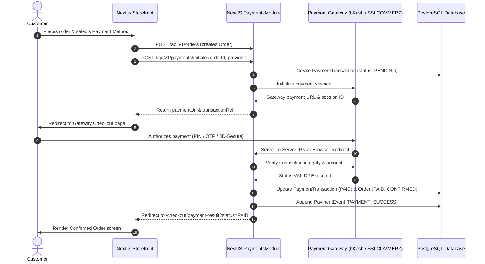

# HIMATU — Payments Engine Specification
## Stage 3 Step 2C: Multi-Channel Gateway Infrastructure & Reconciliation

---

## 1. Unified Payment Lifecycle

The payment engine uses a provider abstraction layer (`IPaymentProvider`) implemented by `BkashProvider`, `SslcommerzProvider`, and `CodProvider`.

---

## 2. API Endpoints

### Customer Endpoints
- `POST /api/v1/payments/initiate`: Initiates a payment session for an order.
  - Body: `{ orderId: string, provider: "BKASH" | "SSLCOMMERZ" | "COD", callbackUrl?: string }`
  - Returns: `{ transactionRef, provider, paymentUrl, orderNumber, amount, currency }`
- `GET /api/v1/payments/:ref`: Fetches transaction details and verification status.
- `GET /api/v1/payments/order/:orderNumber`: Fetches transactions linked to an order.

### Gateway Callbacks & Webhooks
- `GET /api/v1/payments/bkash/callback` & `POST /api/v1/payments/bkash/callback`: bKash payment execution callback. Idempotently checks status, executes payment token, and redirects browser to storefront.
- `POST /api/v1/payments/sslcommerz/success`: SSLCOMMERZ browser redirect upon successful card authorization.
- `POST /api/v1/payments/sslcommerz/fail`: SSLCOMMERZ browser redirect upon card decline.
- `POST /api/v1/payments/sslcommerz/cancel`: SSLCOMMERZ user cancellation redirect.
- `POST /api/v1/payments/sslcommerz/ipn`: Instant Payment Notification server-to-server webhook. Validates payload via SSLCOMMERZ validator API.

### Store Owner & Admin Operations
- `GET /api/v1/admin/payments`: Paginated list of transactions with filters for provider, status, and search query.
- `GET /api/v1/admin/payments/summary`: Aggregated settlement metrics (total volume, paid volume, pending in transit, refunds).
- `GET /api/v1/admin/payments/:id`: Detailed view including gateway session IDs and event audit timeline.
- `POST /api/v1/admin/payments/:id/reconcile`: On-demand reconciliation querying gateway APIs to sync discrepancies.
- `POST /api/v1/admin/payments/:id/refund`: Initiates refund request to gateway and records audit log.
- `GET /api/v1/admin/refunds`: Paginated list of all refunds processed across the store.

---

## 3. Idempotency & Fault Tolerance

- Duplicate webhook notifications or user re-clicks on callback URLs check current database state before modifying records.
- Transactions already marked `PAID` immediately return success without duplicate executions.
- Unverified callback payloads never update order status; all webhooks are verified server-to-server with gateway APIs.

