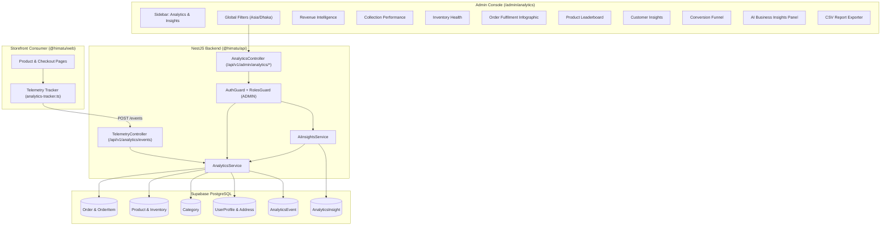

# HIMATU Business Intelligence Center — Analytics Architecture
## Stage 3 Step 2D.1: Full-Stack Business Intelligence & Applied AI Engine

---

## 1. System Overview

The HIMATU Business Intelligence Center extends the Stage 3 Step 2D administrative console with deep operational intelligence, real-time commerce charts, inventory health monitoring, collector behavior analytics, and an applied AI insights engine.

### Key Architectural Pillars
- **Zero Synthetic Mockery**: Every chart, table, and leaderboard queries live database tables (`Order`, `OrderItem`, `Product`, `Category`, `Inventory`, `UserProfile`, `WishlistItem`, `AnalyticsEvent`).
- **Separation of Cash vs. Receivables**: Clearly delineates between collected cash (`DELIVERED` or `PAID`) and open Cash on Delivery receivables (`PENDING`, `CONFIRMED`, `PROCESSING`, `SHIPPED`). Cancelled orders are unconditionally excluded from valid sales.
- **First-Party Telemetry Foundation**: Implemented non-invasive event tracking for the storefront (`storefront_session_started`, `product_viewed`, `add_to_cart`, `checkout_started`, `purchase_completed`) without storing PII or sensitive tokens.
- **Provider-Agnostic AI Insights Engine**: Features configurable provider abstraction supporting Google Gemini with structured output validation and deterministic rule-based grounding fallback.

---

## 2. Monorepo Component Diagram

---

## 3. Endpoints & API Contract

All endpoints under `/api/v1/admin/analytics/*` require valid Supabase JWT bearer tokens and `user.role === 'ADMIN'`.

| Route | Method | Access | Description |
| :--- | :--- | :--- | :--- |
| `/api/v1/analytics/events` | `POST` | Public (Rate-limited) | First-party telemetry ingestion (sessions, views, bag, checkout) |
| `/api/v1/admin/analytics/overview` | `GET` | Admin Only | Unified executive payload combining all 8 modules + insights |
| `/api/v1/admin/analytics/revenue` | `GET` | Admin Only | GOV, collected cash, pending COD, AOV, daily trend, payment distribution |
| `/api/v1/admin/analytics/collections` | `GET` | Admin Only | Anime universe revenue, units sold, growth vs prior period, leaderboard |
| `/api/v1/admin/analytics/inventory` | `GET` | Admin Only | In-stock, low-stock ($\le 5$), out-of-stock ($0$), alerts, category allocations |
| `/api/v1/admin/analytics/orders` | `GET` | Admin Only | Status lifecycle distribution, cancellation rate, awaiting confirmation count |
| `/api/v1/admin/analytics/products` | `GET` | Admin Only | Best sellers by units, top revenue figures, wishlist rankings |
| `/api/v1/admin/analytics/customers` | `GET` | Admin Only | Registered vs paying, repeat purchase rate, Bangladesh district breakdown |
| `/api/v1/admin/analytics/funnel` | `GET` | Admin Only | Telemetry conversion funnel with drop-off percentages and tracking start date |
| `/api/v1/admin/analytics/insights` | `GET` | Admin Only | Generates or retrieves grounded business insights |
| `/api/v1/admin/analytics/insights/generate` | `POST` | Admin Only | Re-evaluates live metrics and generates fresh insights |
| `/api/v1/admin/analytics/insights/history` | `GET` | Admin Only | Audit trail of historical generated insights |

---

## 4. Timezone & Temporal Comparison Mathematics

All temporal reporting is calculated with respect to **BST (`Asia/Dhaka`, UTC+6)**.

### Prior Equivalent Period Calculation
For any reporting window with duration $\Delta t = t_{\text{end}} - t_{\text{start}}$, the preceding baseline comparison period is computed as:
$$t_{\text{prev\_start}} = t_{\text{start}} - \Delta t, \quad t_{\text{prev\_end}} = t_{\text{start}}$$

### Safe Growth Rate (Zero-Baseline Protection)
To prevent misleading division-by-zero infinity errors:
$$\text{Growth \%} = \begin{cases} \text{null (displayed as 'New Baseline')} & \text{if } V_{\text{prev}} \le 0 \\ \frac{V_{\text{current}} - V_{\text{prev}}}{V_{\text{prev}}} \times 100 & \text{if } V_{\text{prev}} > 0 \end{cases}$$

